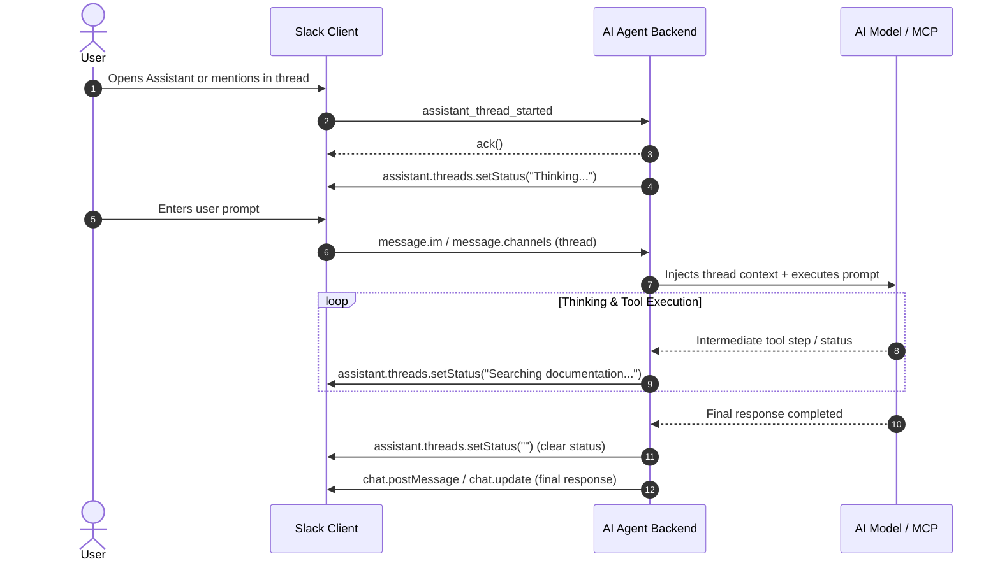

# 🤖 Slack AI Architecture, Agents & MCP Integration

An architectural standard for building enterprise AI agents, assistant containers, Model Context Protocol (MCP) servers, and human-in-the-loop workflows within Slack.

---

## 🎯 Scope & Triggers

Activate this skill when:
- Designing AI-native Slack applications or assistant containers (`assistant_thread_started`).
- Integrating the Model Context Protocol (MCP) with Slack workspace resources and tool calls.
- Implementing conversational thread context extraction and memory injection for LLMs.
- Rendering streaming thinking steps, status chips, or partial responses in Slack threads.
- Building human-in-the-loop approval workflows (e.g., approving actions via Slack buttons before tool execution).
- Managing AI prompt boundaries, data redaction, and tenant-scoped enterprise RAG.

---

## 1. Slack Assistant Containers & Event Lifecycle

Slack provides specialized surfaces for conversational AI assistants. Rather than behaving like a standard bot user, an AI Assistant integrates directly with Slack's dedicated assistant sidebars and dedicated thread spaces.

### A. Core Assistant Lifecycle Events



### B. Listening to Assistant Thread Invocations

```typescript
import { App } from "@slack/bolt";

// 1. User initiates a new assistant thread
app.event("assistant_thread_started", async ({ event, client }) => {
  const { channel_id, thread_ts } = event.assistant_thread;

  // Send a targeted greeting with suggested prompts
  await client.chat.postMessage({
    channel: channel_id,
    thread_ts,
    text: "Hi there! I am your AI assistant. How can I help you today?",
    blocks: [
      {
        type: "section",
        text: { type: "mrkdwn", text: "👋 *How can I help your team today?*" }
      },
      {
        type: "actions",
        elements: [
          {
            type: "button",
            text: { type: "plain_text", text: "📊 Analyze active polls" },
            action_id: "ai_prompt_analyze_polls"
          },
          {
            type: "button",
            text: { type: "plain_text", text: "📋 Summarize team consensus" },
            action_id: "ai_prompt_summarize_consensus"
          }
        ]
      }
    ]
  });
});
```

---

## 2. Dynamic Thinking Indicators & Status Chips

Users experience high drop-off rates when AI agents sit silently while executing multi-step LLM reasoning or tool calls. Always broadcast real-time state using `assistant.threads.setStatus`:

```typescript
export async function runAgentWorkflow(
  client: WebClient,
  channel: string,
  threadTs: string,
  userPrompt: string
): Promise<void> {
  // Step 1: Set initial status indicator
  await client.assistant.threads.setStatus({
    channel_id: channel,
    thread_ts: threadTs,
    status: "Reviewing workspace discussion..."
  });

  // Step 2: Intermediate tool execution
  const context = await fetchThreadContext(client, channel, threadTs);
  await client.assistant.threads.setStatus({
    channel_id: channel,
    thread_ts: threadTs,
    status: "Synthesizing consensus..."
  });

  // Step 3: Stream or post final response
  const responseText = await queryLanguageModel(userPrompt, context);

  // Step 4: Clear status and post final message
  await client.assistant.threads.setStatus({
    channel_id: channel,
    thread_ts: threadTs,
    status: "" // Setting empty string clears the indicator
  });

  await client.chat.postMessage({
    channel,
    thread_ts: threadTs,
    text: responseText
  });
}
```

---

## 3. Model Context Protocol (MCP) in Slack

The Model Context Protocol (MCP) provides a standardized protocol for connecting AI agents directly to tools, external systems, and workspace data.

### A. Slack as an MCP Client
When your AI agent utilizes MCP to query external tools:
1. Wrap tool definitions into standard JSON Schema descriptors.
2. When the model selects an MCP tool call (e.g., `query_database` or `fetch_jira_issue`), update the Slack status indicator to reflect the tool name.
3. If an MCP tool performs a **destructive or mutating action** (e.g., `delete_channel`, `merge_pull_request`), trigger a **Human-in-the-Loop** confirmation block.

### B. Human-in-the-Loop Confirmation Pattern
Never let an autonomous agent perform destructive operations without explicit user confirmation in the thread:

```typescript
export async function promptHumanApproval(
  client: WebClient,
  channel: string,
  threadTs: string,
  actionPlan: { actionName: string; summary: string; executionId: string }
): Promise<void> {
  await client.chat.postMessage({
    channel,
    thread_ts: threadTs,
    text: `⚠️ Approval required: ${actionPlan.summary}`,
    blocks: [
      {
        type: "section",
        text: {
          type: "mrkdwn",
          text: `⚠️ *Approval Required*\nThe agent wants to execute:\n> *${actionPlan.actionName}*\n${actionPlan.summary}`
        }
      },
      {
        type: "actions",
        elements: [
          {
            type: "button",
            style: "primary",
            text: { type: "plain_text", text: "Approve" },
            value: actionPlan.executionId,
            action_id: "agent_approve_tool_execution"
          },
          {
            type: "button",
            style: "danger",
            text: { type: "plain_text", text: "Reject" },
            value: actionPlan.executionId,
            action_id: "agent_reject_tool_execution"
          }
        ]
      }
    ]
  });
}
```

---

## 4. Conversational Context & Memory Extraction

When generating responses in a Slack thread, the agent must inspect the conversation history while respecting privacy and token window bounds:

### A. Extracting Clean Thread History
```typescript
export async function getCleanThreadHistory(
  client: WebClient,
  channel: string,
  threadTs: string,
  maxMessages = 10
): Promise<Array<{ role: "user" | "assistant"; content: string }>> {
  const result = await client.conversations.replies({
    channel,
    ts: threadTs,
    limit: maxMessages
  });

  if (!result.messages) return [];

  return result.messages
    .filter((msg) => msg.text && !msg.subtype)
    .map((msg) => ({
      role: msg.bot_id ? "assistant" : "user",
      content: msg.text || ""
    }));
}
```

---

## 5. AI Agent Quality & Safety Checklist

- [ ] **Visual Feedback**: The agent invokes `assistant.threads.setStatus` within 1 second of user input to indicate thinking/searching.
- [ ] **Human-in-the-Loop Safeguards**: Destructive or irreversible actions require an interactive button confirmation before execution.
- [ ] **Token Truncation**: Conversation history extraction is bounded (e.g., last 10–15 messages) to prevent context window overflow.
- [ ] **Status Cleanup**: `setStatus("")` is called upon completion or within a `finally` block to prevent stuck spinners.
- [ ] **Clean Fallbacks**: If the AI model fails or times out, an informative, actionable message is posted to the thread.
