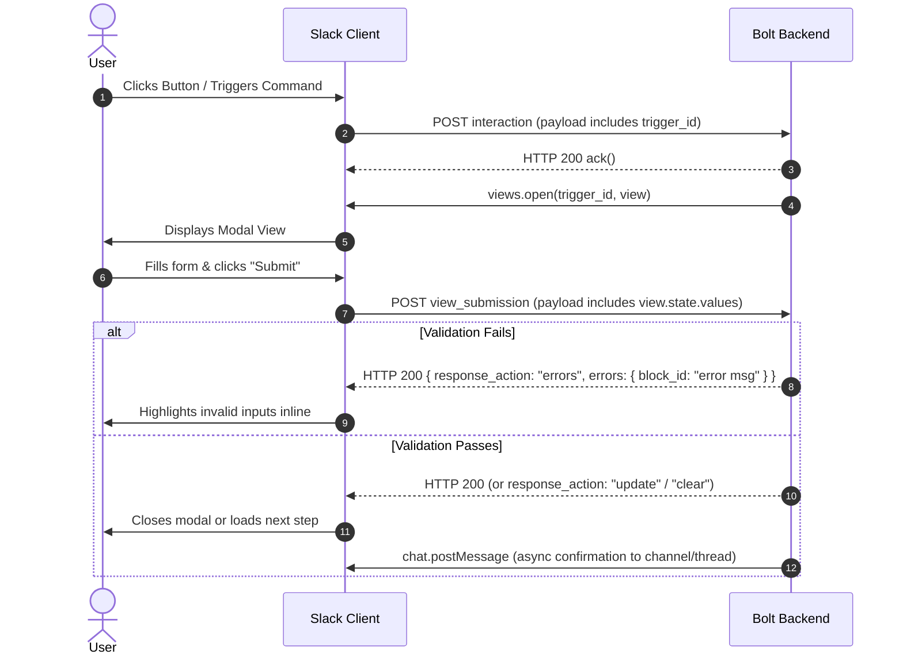

# 🎨 Slack Block Kit & Interactive UI Architecture

A comprehensive technical standard for architecting, composing, and rendering interactive Slack interfaces using Block Kit, Modals, App Home tabs, and deterministic message updates.

---

## 🎯 Scope & Triggers

Activate this skill when:
- Designing or implementing Block Kit message payloads, modals, or App Home surfaces.
- Building interactive modals with `views.open`, `views.update`, `views.push`, or handling `view_submission`.
- Handling input validation errors inside modals using `response_action: "errors"`.
- Publishing or refreshing App Home tabs via `views.publish` and handling `app_home_opened`.
- Implementing in-place message updates with `chat.update` using stored message timestamps (`ts`).
- Working within Slack's Block Kit constraints (50-block maximum, action ID uniqueness, block ID scoping).
- Eliminating system clock dependencies in view builders (enforcing clock-free, pure UI renderers).

---

## 1. Block Kit Composition Rules & Constraints

Slack layouts are constructed from an array of blocks (maximum **50 blocks** per surface). Every block must be purpose-built to balance readability and interaction limits.

### A. Surface Constraints Matrix

| Surface | Block Limit | Input Blocks Allowed? | Primary Method | Best Use Case |
|---|---|---|---|---|
| **Message** (Channel / DM) | 50 blocks | ❌ No (inputs restricted to Modals) | `chat.postMessage`, `chat.update` | Notifications, polls, action feeds, alerts |
| **Modal View** | 100 blocks | ✅ Yes (`input` blocks required for text/pickers) | `views.open`, `views.update`, `views.push` | Forms, complex surveys, multi-step wizards |
| **App Home Tab** | 100 blocks | ❌ No (use buttons to trigger Modals for input) | `views.publish` | Dashboards, persistent metrics, app settings |
| **Ephemeral Message** | 50 blocks | ❌ No | `chat.postEphemeral` | Contextual confirmations, error feedback |

### B. Block & Action ID Discipline
- **`block_id`**: Identifies a logical section. Slack groups form state under `view.state.values[block_id][action_id]`. Always assign deterministic, namespaced `block_id`s (e.g., `poll_title_block`, `option_1_block`).
- **`action_id`**: Identifies the interactive element within the block (e.g., `vote_button_opt_1`, `title_input_action`).
- **Uniqueness**: Never reuse the same `action_id` within the same view or interactive block.

### C. Clock-Free Pure UI Invariant
Block Kit view builders must be **100% pure functions**:
```typescript
// ❌ WRONG: Reading the system clock inside the view builder
export function buildPollView(poll: PollData): View {
  const isExpired = Date.now() > poll.expiresAt; // Direct clock dependency!
  // ...
}

// ✅ CORRECT: Injecting computed state into the builder
export function buildPollView(poll: PollData, context: { isExpired: boolean; formattedRemainingTime: string }): View {
  // Pure rendering logic based strictly on input arguments
}
```

---

## 2. Dynamic Modals & View Lifecycle

Modals require a valid `trigger_id` obtained from user interactions (button click, slash command, shortcut) and must be opened within **3 seconds** of receiving the trigger.



### A. Modal Stack Management (`open` vs `update` vs `push`)
- **`views.open`**: Spawns a new root modal. Requires `trigger_id`.
- **`views.update`**: Replaces the active view in-place. Requires `view_id` and the current `hash` (to prevent concurrency race conditions).
- **`views.push`**: Pushes a new view onto the modal stack (up to **3 levels deep**). Requires `trigger_id` generated from an interaction inside the active modal.
- **`response_action: "push"`**: Alternative to `views.push` returned synchronously during `view_submission`.

### B. Handling `view_submission` & 3-Second Timeout
Slack gives applications **strictly 3 seconds** to acknowledge a `view_submission`.

#### Pattern 1: Inline Validation Error
Return validation errors directly in the acknowledgement payload:
```typescript
app.view("poll_create_modal", async ({ ack, body, view }) => {
  const title = view.state.values["title_block"]?.["title_input"]?.value?.trim();

  if (!title || title.length < 5) {
    await ack({
      response_action: "errors",
      errors: {
        title_block: "Poll title must be at least 5 characters long."
      }
    });
    return;
  }

  // Validation passed: acknowledge modal closure immediately
  await ack();

  // Perform background operations asynchronously
  await createPollRecord(body.user.id, view.state.values);
});
```

#### Pattern 2: Multi-Step Wizards (`response_action: "update"`)
```typescript
await ack({
  response_action: "update",
  view: nextStepModalView
});
```

---

## 3. App Home Tab Architecture (`views.publish`)

The App Home tab provides a persistent dashboard for every user. Unlike messages, App Home is private and personal to each user in the workspace.

### A. The `app_home_opened` Event Pattern
Publish the Home tab view every time the user opens the tab, or update it in the background when app state changes:
```typescript
app.event("app_home_opened", async ({ event, client }) => {
  if (event.tab !== "home") return;

  const userStats = await getUserPollStats(event.user);
  const homeView = buildAppHomeView(event.user, userStats);

  await client.views.publish({
    user_id: event.user,
    view: homeView
  });
});
```

### B. Best Practices for App Home Tabs
1. **Interactive Triggers**: Since App Home does not support direct `input` blocks, use buttons (`Create Poll`, `Configure Settings`) that invoke `views.open` with the click's `trigger_id`.
2. **Empty States**: Always design clear, welcoming empty states when a user has no active data. Never leave an App Home blank.
3. **Optimistic Updates**: When a user interacts with a toggle or button in App Home, call `views.publish` immediately with the updated UI before long-running tasks finish.

---

## 4. In-Place Message Updates (`chat.update`)

Flooding channels with new messages creates cognitive fatigue and degrades user experience. **Always update existing messages in-place** whenever state changes.

### A. Timestamp (`ts`) Persistence
Every message posted via `chat.postMessage` returns a unique timestamp string (`ts`, e.g., `"1684321987.012300"`). 
- Always store `{ channelId, messageTs }` alongside the entity record in your database.
- Use `chat.update` with the stored `channel` and `ts` to update the message.

```typescript
export async function updatePollMessage(
  client: WebClient,
  channel: string,
  ts: string,
  poll: PollAggregate
): Promise<void> {
  const blocks = renderPollBlocks(poll);

  await client.chat.update({
    channel,
    ts,
    text: `Poll: ${poll.title} (${poll.totalVotes} votes)`, // Fallback plain text
    blocks
  });
}
```

### B. Ephemeral Confirmations (`chat.postEphemeral`)
For individual feedback that shouldn't clutter the public channel:
- Use `chat.postEphemeral` to confirm a vote or show validation errors.
- Pass `user: body.user.id` and `channel: body.channel.id`.

---

## 5. Defensive Block Kit Checklist

- [ ] **Max 50 Blocks**: Message payload contains $\le 50$ blocks.
- [ ] **Text Length Limits**: Header blocks $\le 150$ chars; Section text $\le 3000$ chars; Button text $\le 75$ chars.
- [ ] **Fallback Plain Text**: `text` parameter is always supplied alongside `blocks` in `chat.postMessage` and `chat.update` for push notifications and accessibility.
- [ ] **No System Clocks in View Builders**: Timestamps and formatted countdowns are computed outside and injected into view functions.
- [ ] **Unique Action IDs**: No duplicate `action_id`s within the same interactive block.
- [ ] **3-Second Ack**: All `block_actions` and `view_submission` handlers execute `ack()` immediately.
