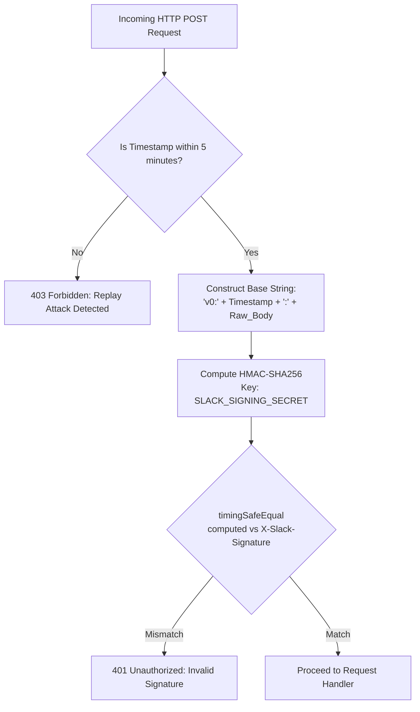

# 🔐 Slack Security, Authentication & Token Governance

An enterprise-grade engineering specification for cryptographic signature verification, OAuth 2.0 lifecycle management, automated configuration token rotation, and multi-tenant security isolation.

---

## 🎯 Scope & Triggers

Activate this skill when:
- Implementing or verifying incoming Slack request authenticity (`X-Slack-Signature`).
- Protecting endpoints against timing attacks and replay attacks.
- Designing multi-tenant OAuth 2.0 installation flows and token storage databases.
- Automating CI/CD pipelines with App Configuration Access Tokens (`xoxe-`) and rotation mechanics (`tooling.tokens.rotate`).
- Isolating data and credentials across Enterprise Grid organizations (`enterprise_id`, `is_enterprise_install`).
- Auditing OAuth scope footprints to uphold the principle of least privilege.

---

## 1. Cryptographic Request Signature Verification

Every incoming HTTP request from Slack includes two security headers:
- `X-Slack-Request-Timestamp`: The epoch timestamp (seconds) when Slack sent the request.
- `X-Slack-Signature`: The cryptographic signature (`v0=...`) computed using the app's **Signing Secret**.

### A. The Verification Algorithm



### B. Production Implementation (Node.js / TypeScript)

> [!CAUTION]
> Always verify the raw, unparsed request body string. Parsing JSON or URL-encoded bodies before signature verification modifies whitespace and ordering, causing signature validation to fail.

```typescript
import crypto from "crypto";

interface VerificationInput {
  signingSecret: string;
  signatureHeader: string | undefined;  // X-Slack-Signature
  timestampHeader: string | undefined;  // X-Slack-Request-Timestamp
  rawBody: string;                      // Unparsed raw UTF-8 string
}

export function verifySlackSignature(input: VerificationInput): boolean {
  const { signingSecret, signatureHeader, timestampHeader, rawBody } = input;

  if (!signatureHeader || !timestampHeader) {
    return false;
  }

  // 1. Defend against Replay Attacks (Max 5 minutes clock drift)
  const currentTimestamp = Math.floor(Date.now() / 1000);
  const requestTimestamp = parseInt(timestampHeader, 10);
  if (isNaN(requestTimestamp) || Math.abs(currentTimestamp - requestTimestamp) > 300) {
    return false;
  }

  // 2. Construct the Signature Base String
  const sigBaseString = `v0:${requestTimestamp}:${rawBody}`;

  // 3. Compute HMAC-SHA256
  const hmac = crypto.createHmac("sha256", signingSecret);
  hmac.update(sigBaseString, "utf8");
  const computedSignature = `v0=${hmac.digest("hex")}`;

  // 4. Timing-Safe Comparison (Prevents Side-Channel Timing Attacks)
  const signatureBuffer = Buffer.from(signatureHeader, "utf8");
  const computedBuffer = Buffer.from(computedSignature, "utf8");

  if (signatureBuffer.length !== computedBuffer.length) {
    return false;
  }

  return crypto.timingSafeEqual(signatureBuffer, computedBuffer);
}
```

---

## 2. Token Types & Lifecycle Governance

Slack issues distinct token types based on functionality and privilege boundaries:

| Token Prefix | Token Name | Lifespan | Storage Requirement | Primary Scope |
|---|---|---|---|---|
| `xoxb-` | **Bot Token** | Indefinite (until uninstalled/revoked) | Encrypted DB (`AES-256-GCM`) per workspace | Bot actions (`chat:write`, `commands`, `views:open`) |
| `xoxp-` | **User Token** | Indefinite (until user revokes) | Encrypted DB per user + workspace | Actions acting explicitly as the authorizing user |
| `xoxe-` | **App Configuration Access Token** | **Strict 12 Hours** | Secret Manager / CI Environment | Programmatic manifest management via Web API |
| `xoxe-1-` | **Configuration Refresh Token** | Rotating | Vault / AWS Secrets Manager | Used to rotate `xoxe-` access tokens |

### A. Programmatic Token Rotation for CI/CD Pipelines
Configuration tokens (`xoxe-`) expire every **12 hours**. Automated deployment pipelines must proactively rotate the token prior to executing manifest commands:

```typescript
interface TokenRotationResponse {
  ok: boolean;
  token: string;         // New xoxe- access token (valid 12h)
  refresh_token: string; // New refresh token for the NEXT cycle
  exp: number;
}

export async function rotateConfigurationToken(currentRefreshToken: string): Promise<TokenRotationResponse> {
  const response = await fetch("https://slack.com/api/tooling.tokens.rotate", {
    method: "POST",
    headers: { "Content-Type": "application/x-www-form-urlencoded" },
    body: new URLSearchParams({ refresh_token: currentRefreshToken })
  });

  const data = await response.json();
  if (!data.ok) {
    throw new Error(`Token rotation failed: ${data.error}`);
  }

  // Immediately persist data.refresh_token to your secret store
  return data;
}
```

---

## 3. Multi-Tenant Installation Security

When distributing apps across multiple workspaces, enforce strict cryptographic boundary isolation:

### A. OAuth State Parameter Validation (Anti-CSRF)
Never initiate an OAuth flow without a cryptographically random, signed `state` token:
1. Generate `state = hmac(session_id + timestamp, app_secret)`.
2. Store `state` in an HTTP-only, secure session cookie.
3. Upon receiving `/slack/oauth_redirect`, assert `query.state === cookie.state`.

### B. Multi-Tenant Database Encryption
Store bot tokens using authenticated encryption (`AES-256-GCM`):
```typescript
interface EncryptedTokenRecord {
  teamId: string;
  enterpriseId?: string;
  iv: string;         // Initialization Vector (12 bytes, hex)
  authTag: string;    // Authentication Tag (16 bytes, hex)
  ciphertext: string; // Encrypted xoxb- token
}
```

---

## 4. Enterprise Grid Isolation (`enterprise_id`)

Enterprise Grid deployments group dozens or hundreds of workspaces under an overarching organization:
- **Org-Wide Installation**: When an app is installed org-wide (`is_enterprise_install: true`), Slack issues a single `xoxb-` token valid across all workspaces in the Enterprise Grid.
- **Tenant Isolation Invariant**: Never use a workspace-level query that assumes `team_id` is always present. In org-wide installs:
  ```typescript
  // Lookup credential by enterprise_id first when present
  const installation = await db.installation.findFirst({
    where: enterpriseId 
      ? { enterpriseId, isEnterpriseInstall: true } 
      : { teamId }
  });
  ```
- **Cross-Workspace Data Leak Prevention**: Ensure poll responses, vote counts, and user identities are partitioned by `{ enterpriseId, teamId }` compound keys.

---

## 5. Security Audit Checklist

- [ ] **Constant-Time Verification**: `crypto.timingSafeEqual` is used for signature validation (no `===` or `==`).
- [ ] **Replay Defense Window**: Requests older or newer than $\pm 300$ seconds are rejected immediately.
- [ ] **Raw Body Preservation**: Body parser middleware captures the raw Buffer/string prior to JSON deserialization.
- [ ] **At-Rest Token Encryption**: All `xoxb-` and `xoxp-` tokens are encrypted at rest with `AES-256-GCM`.
- [ ] **Zero Hardcoded Secrets**: Secrets (`SLACK_SIGNING_SECRET`, `SLACK_CLIENT_SECRET`) are injected via environment variables.
