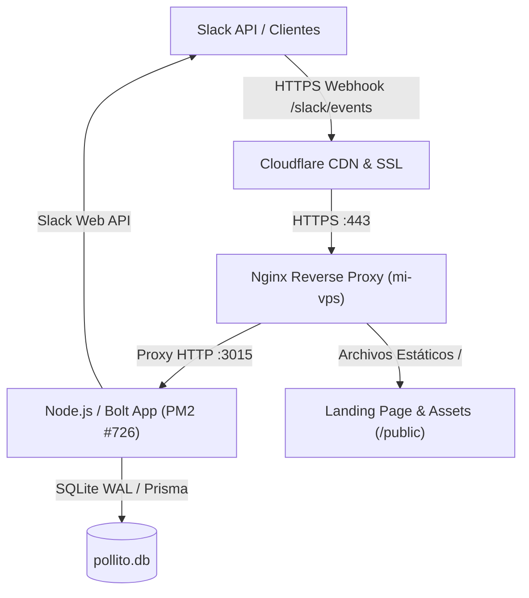
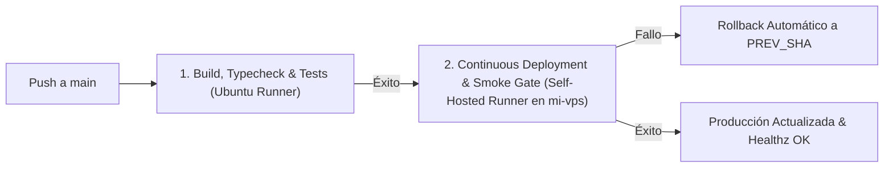
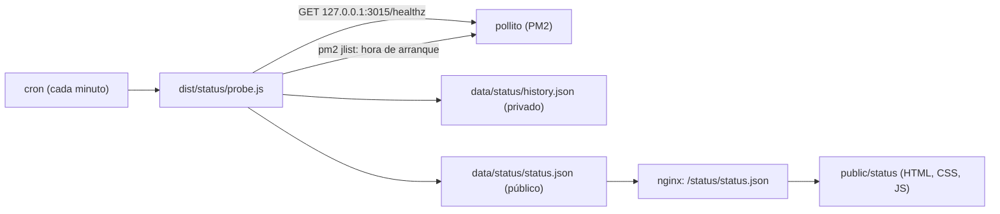

# Manual de Operaciones y Arquitectura — Pollito

Este documento contiene la guía operativa completa de **Pollito**: arquitectura de producción, administración del VPS, pipeline de CI/CD en GitHub Actions, gestión segura de credenciales (Blind-Secret Protocol) y mantenimiento de la Slack App.

---

## 1. Arquitectura del Sistema

Pollito es una aplicación nativa de Slack para decisiones de equipo. Combina votaciones públicas y anónimas (mediante doble urna criptográfica con `HKDF-SHA256`), barras de progreso en vivo, recordatorios privados a quienes faltan por votar y cierre automático por quórum o temporizador.



### Componentes Técnicos

* **Runtime & Framework**: Node.js 22 + TypeScript + `@slack/bolt`.
* **Transporte**:
  * **Producción**: HTTP Nativo (`HTTPReceiver`) en `http://127.0.0.1:3015`. Recibe y valida criptográficamente peticiones en `/slack/events`, `/slack/install` y `/slack/oauth_redirect`.
  * **Desarrollo local (opcional)**: Socket Mode vía WebSocket con `SLACK_SOCKET_MODE=true` y `SLACK_APP_TOKEN` (`xapp-...`).
* **Base de datos**: SQLite en modo WAL administrada con Prisma ORM (`prisma/pollito.db`).
* **Web & Reverse Proxy**: Nginx con certificados Let's Encrypt y proxy inverso hacia el puerto local 3015.
* **Process Manager**: PM2 en `mi-vps` (nombre de proceso: `pollito`, ID actual: `726`).
* **Dominio oficial**: `https://pollito.tbelt.online`.

---

## 2. Guía de Credenciales y Tokens (Blind-Secret Protocol)

> [!CAUTION]
> **Regla de Oro de Seguridad**: Nunca pegues tokens ni secretos en texto plano dentro del chat, issues, commits ni comandos bash con banderas directas (para evitar que queden registrados en `~/.zsh_history` o en logs del modelo). Utiliza siempre los scripts interactivos de captura silenciosa.

### Dónde encontrar cada credencial en Slack

Gestionas todas las credenciales desde la consola de desarrollador en **[api.slack.com/apps/A0C9YDMH6CV](https://api.slack.com/apps/A0C9YDMH6CV)**:

| Credencial | Dónde encontrarla en Slack Console | Para qué sirve | Formato |
| :--- | :--- | :--- | :--- |
| **`SLACK_SIGNING_SECRET`** | **Basic Information** ➔ sección **App Credentials** ➔ campo **Signing Secret** (pulsa *Show* y copia). | Valida la firma HMAC-SHA256 (`x-slack-signature`) de cada webhook entrante para verificar que proviene legítimamente de Slack. | Hexadecimal de 32 caracteres (ej: `a1b2c3d4...`). |
| **`SLACK_BOT_TOKEN`** | **OAuth & Permissions** ➔ sección **Tokens for Your Workspace** ➔ campo **Bot User OAuth Token**. | Autentica a Pollito para enviar mensajes, unirse a canales y consultar miembros en la API de Slack. | Cadena que inicia con **`xoxb-`**. |
| **`SLACK_CLIENT_ID`** | **Basic Information** ➔ sección **App Credentials** ➔ campo **Client ID**. | Identifica la aplicación en los flujos de instalación multi-workspace de OAuth 2.0. | Cadena numérica o alfanumérica. |
| **`SLACK_CLIENT_SECRET`** | **Basic Information** ➔ sección **App Credentials** ➔ campo **Client Secret** (pulsa *Show* y copia). | Autentica el intercambio del código de autorización por tokens en OAuth 2.0. | Hexadecimal de 32 caracteres. |
| **`SLACK_STATE_SECRET`** | Generado automáticamente en servidor / `.env`. | Secreto criptográfico para firmar cookies `state` y mitigar ataques CSRF durante la instalación OAuth. | Hexadecimal aleatorio de 32 bytes (64 caracteres). |
| **`SLACK_APP_TOKEN`** *(Opcional)* | **Basic Information** ➔ sección **App-Level Tokens** (token con scope `connections:write`). | Requerido únicamente si activas Socket Mode para desarrollo local. | Cadena que inicia con **`xapp-`**. |
| **`APP_SECRET_SALT`** | Generado automáticamente en servidor / `.env`. | Sal criptográfica privada para derivar tokens de voto anónimo (`HKDF-SHA256` junto con `anonymousSalt`) y cifrar tokens OAuth en reposo (`AES-256-GCM`). | Cadena aleatoria de al menos 32 caracteres. |

> [!IMPORTANT]
> **Revocación automática de tokens al reinstalar**: Cada vez que agregues o modifiques *Scopes* en Slack y pulses **Reinstall to Workspace**, Slack **invalida el `SLACK_BOT_TOKEN` anterior** y genera uno nuevo. Cuando esto ocurra, debes actualizar el bot token en el servidor usando el script interactivo.

---

### Ingestión Segura mediante Scripts Interactivos

El repositorio incluye herramientas interactivas con lectura silenciosa (`read -s -r`) que configuran `/home/jhonatan/pollito/.env` en el VPS con permisos restrictivos `chmod 600` sin dejar rastro:

#### 1. Actualizar ambas credenciales (Bot Token y Signing Secret)
Ejecuta desde tu terminal de macOS:
```bash
bash scripts/setup-slack-secrets.sh
```

#### 2. Actualizar únicamente el Bot Token (`xoxb-...`) tras una reinstalación
Ejecuta directamente:
```bash
ssh -t mi-vps "/home/jhonatan/pollito/scripts/setup-bot-token.sh"
```
*El script solicita el token de forma invisible, actualiza el `.env`, reinicia el proceso en PM2 y ejecuta una prueba inmediata de `auth.test` contra Slack.*

#### 3. Actualizar únicamente el Signing Secret
Ejecuta:
```bash
ssh -t mi-vps "/home/jhonatan/pollito/scripts/setup-signing-secret.sh"
```

#### 4. Configurar credenciales OAuth multi-workspace (`SLACK_CLIENT_ID` y `SLACK_CLIENT_SECRET`)
Ejecuta desde tu terminal de macOS:
```bash
bash scripts/setup-oauth-secrets.sh
```
*El script solicita `SLACK_CLIENT_ID` y `SLACK_CLIENT_SECRET` de forma silenciosa, auto-genera `SLACK_STATE_SECRET` si no existe, actualiza el `.env` en `mi-vps` con permisos `chmod 600`, reinicia PM2 y verifica `/healthz`.*

---

## 3. Administración del Servidor VPS (`mi-vps`)

* **Host SSH**: `mi-vps` (acceso por llave SSH configurado en `~/.ssh/config`).
* **Ruta del proyecto**: `/home/jhonatan/pollito`.
* **Archivo de entorno**: `/home/jhonatan/pollito/.env` (permisos `600`).

### Comandos de Operación con PM2

```bash
# Ver estado del proceso y consumo de recursos
ssh mi-vps "pm2 status pollito"

# Inspeccionar logs en tiempo real
ssh mi-vps "pm2 logs pollito"

# Ver las últimas 50 líneas de salida estándar y errores
ssh mi-vps "pm2 logs pollito --lines 50 --nostream"

# Reiniciar el bot (forzando recarga de variables .env)
ssh mi-vps "pm2 restart pollito --update-env"
```

### Verificación de Endpoints y Salud

```bash
# Comprobación de salud local en el puerto del bot
ssh mi-vps "curl -fsS http://127.0.0.1:3015/healthz"

# Comprobación pública externa vía Cloudflare / HTTPS
curl -fsS https://pollito.tbelt.online/healthz
```

Respuesta esperada:
```json
{"status":"ok","app":"pollito","timestamp":"2026-10-18T..."}
```

### Configuración de Nginx

El virtual host reside en `/etc/nginx/sites-enabled/pollito.tbelt.online.conf`:
* `/healthz` ➔ Redirige al puerto interno `3015`.
* `/slack/` ➔ Proxy reverso hacia `http://127.0.0.1:3015` para webhooks (`/slack/events`) y flujo OAuth (`/slack/install`, `/slack/oauth_redirect`).
* `/` ➔ Sirve la landing page estática y assets desde `/home/jhonatan/pollito/public`.

Para verificar la sintaxis de Nginx tras tus modificaciones:
```bash
ssh mi-vps "nginx -t && systemctl reload nginx"
```

---

## 4. Pipeline de CI/CD en GitHub Actions

El flujo de integración y despliegue continuo está definido en [`.github/workflows/ci.yml`](file:///Users/jhonatan/Documents/pollito/.github/workflows/ci.yml).

### Fases del Pipeline



#### Fase 1: Build, Typecheck & Test Suite (GitHub Hosted Runner)
1. Instala Node.js 22 y `pnpm 11.7.0`.
2. Ejecuta `pnpm install --frozen-lockfile`.
3. Genera el cliente de Prisma (`pnpm db:generate`) y sincroniza un esquema SQLite temporal en memoria (`pnpm db:push`).
4. Corre los tests automatizados y el linter de Anti-AI Slop (`pnpm test` con Vitest).
5. Compila TypeScript con verificación estricta de tipos (`pnpm build`).

#### Fase 2: Continuous Deployment & Smoke Gate (Runner Self-Hosted `[self-hosted, pollito]`)
1. Corre exclusivamente en commits enviados a la rama `main`.
2. Se conecta al directorio de producción `/home/jhonatan/pollito`.
3. Registra el `PREV_SHA` del commit en producción antes de actualizar.
4. Activa un manejador de fallos (`trap rollback ERR`) que revierte automáticamente al commit anterior (`git reset --hard $PREV_SHA`), restaura dependencias y levanta el servicio previo si falla la compilación, la base de datos o la verificación de salud.
5. Ejecuta `git reset --hard origin/main`, `pnpm install`, `pnpm db:push` y `pnpm build`.
6. Reinicia el proceso con `pm2 restart pollito --update-env`.
7. **Smoke Test Gate**: Ejecuta hasta 15 intentos consecutivos contra `http://127.0.0.1:3015/healthz` y valida el endpoint público de Cloudflare antes de declarar exitoso el despliegue.

### Monitoreo del CI/CD desde la Terminal

```bash
# Ver las ejecuciones recientes del workflow
gh run list --limit 3

# Seguir en vivo la ejecución en curso
gh run watch <run_id>
```

---

## 5. Configuración de Slack App (`manifest.json`)

El archivo [`manifest.json`](file:///Users/jhonatan/Documents/pollito/manifest.json) define las capacidades y permisos requeridos por Pollito:

### Bot Scopes Requeridos
* **`commands`**: Registra y escucha el comando de barra `/pollito`.
* **`chat:write`**: Permite publicar tarjetas interactivas de votación en canales.
* **`chat:write.public`**: Permite publicar encuestas en cualquier canal público sin requerir invitación manual previa.
* **`channels:join`**: Permite al bot auto-unirse a canales públicos al interactuar.
* **`channels:read`**, **`groups:read`**, **`im:read`**, **`mpim:read`**: Permite leer listas de miembros para calcular el porcentaje de quórum.
* **`im:write`**: Permite enviar recordatorios directos (Smart Nudges) a los miembros que aún no han votado.
* **`users:read`**: Permite resolver menciones y creadores de votaciones.

### Endpoints Registrados en Slack Console
* **Interactivity Request URL**: `https://pollito.tbelt.online/slack/events`
* **Event Subscriptions Request URL**: `https://pollito.tbelt.online/slack/events` (evento: `app_home_opened`)
* **Slash Command `/pollito` Request URL**: `https://pollito.tbelt.online/slack/events`
* **OAuth Redirect URL**: `https://pollito.tbelt.online/slack/oauth_redirect`

---

## 6. Base de Datos y Modelo de Datos (Prisma + SQLite)

El esquema reside en [`prisma/schema.prisma`](file:///Users/jhonatan/Documents/pollito/prisma/schema.prisma) y la base de datos de producción se almacena en `/home/jhonatan/pollito/prisma/pollito.db`.

### Modelos Principales
* **`Workspace`**: Registro del workspace de Slack (`id = T...`), token cifrado (`AES-256-GCM`) y fecha de instalación.
* **`WorkspaceSettings`**: Configuración de privacidad, porcentaje de quórum por defecto y sal privada (`anonymousSalt`) para seudonimización.
* **`Poll`**: Pregunta, canal, timestamp del mensaje en Slack, creador, modo de opción múltiple (`allowMultipleVotes`), tipo de quórum, fecha límite (`closesAt`) y estado (`ACTIVE`, `QUORUM_REACHED`, `CLOSED`, `TIME_EXPIRED`).
* **`PollOption`**: Opciones de la votación con su índice y contador de votos.
* **`PublicVote`**: Registro transparente de votos públicos (`voterId` visible).
* **`AnonymousBallot`**: Voto anónimo indexado únicamente por `voterToken` (doble urna con `UUID` aleatorio y sin `createdAt`, disociando la identidad del usuario de su opción elegida).
* **`PollParticipation`**: Control de participación (registra quién votó para bloquear el doble voto sin revelar qué opción eligió en votaciones anónimas).
* **`NudgeLog`**: Registro de enfriamiento (4 horas por encuesta) para los recordatorios privados enviados a quienes faltan por votar.

### Invariante de Autocreación de Workspaces
Para evitar violaciones de clave foránea (`Foreign key constraint violated`) cuando la app se instala manualmente desde la consola de Slack sin pasar por la URL de OAuth, `PollService.createPoll` ejecuta un `prisma.workspace.upsert` automático garantizando la existencia del workspace y su sal criptográfica antes de guardar la encuesta.

### Comandos de Base de Datos
```bash
# Generar cliente de Prisma tras editar schema.prisma
pnpm db:generate

# Sincronizar cambios de esquema con la base de datos SQLite
pnpm db:push
```

---

## 7. Pruebas y Calidad de Código

Antes de enviar cualquier cambio a `main`, ejecuta localmente:

```bash
# Ejecutar suite de pruebas con Vitest (incluye linter de Anti-AI Slop)
pnpm test

# Compilación TypeScript y verificación de tipos
pnpm build
```

La suite valida:
1. **Doble urna anónima**: Inmutabilidad, determinismo y no trazabilidad de tokens de votación.
2. **Cálculo de quórums**: Comportamiento de cierre por porcentaje o conteo de miembros.
3. **Barra de progreso**: Renderizado monoespaciado en bloques de 10 caracteres.
4. **Anti-AI Slop Gate** (`tests/copy/antiSlop.test.ts`): Baneo estricto de clichés corporativos (*"workspace dashboard"*, *"synergize"*, contrastes binarios *"not X, but Y"*).

---

## 7. Página de estado pública (`pollito.tbelt.online/status`)

La página es estática (`public/status/`) y lee un único archivo, `status.json`, que genera una sonda local cada minuto. Nada interno llega al exterior: el JSON solo contiene estado, porcentajes de disponibilidad, segundos desde el último arranque, tiempo de respuesta medio y marcas de tiempo de reinicios y caídas.



### Puesta en marcha (una sola vez, requiere acciones fuera del repositorio)

No hacen falta DNS ni certificado nuevos: la página cuelga del dominio de Pollito.

1. **nginx**: pegar el bloque de `deploy/nginx/pollito-status-location.conf` dentro del `server` de `/etc/nginx/sites-enabled/pollito.tbelt.online.conf` y ejecutar `nginx -t && systemctl reload nginx`.
2. **Sonda**: tras el siguiente despliegue existe `dist/status/probe.js`. Añadir al crontab del usuario que ejecuta PM2 (necesita `pm2 jlist`):

```bash
* * * * * cd /home/jhonatan/pollito && /usr/bin/node dist/status/probe.js >> /home/jhonatan/pollito/data/status/probe.log 2>&1
```

3. **Verificar**: `cat data/status/status.json` debe mostrar `"state":"operational"` y `curl -fsS https://pollito.tbelt.online/status/status.json` debe devolver lo mismo. La página está en `https://pollito.tbelt.online/status/`.

### Comportamiento

* Si la sonda deja de ejecutarse, la página muestra "Status updates are delayed" a partir de 5 minutos, en vez de un falso "todo bien".
* Si el bot cae, la sonda lo detecta (falla `/healthz`) y registra una caída con su duración. Si el servidor entero se reinicia, los minutos sin muestras se cuentan como caída. Si el VPS completo está apagado, la página también cae, porque vive en él. Para cubrir ese caso habría que alojarla fuera (por ejemplo, Cloudflare Pages con un subdominio `status`).
* Variables opcionales de la sonda: `STATUS_HEALTH_URL`, `STATUS_PM2_NAME` y `STATUS_DATA_DIR`.
* Los reinicios se detectan por cambio en la hora de arranque del proceso. Se cuentan los posteriores a la primera ejecución de la sonda.
