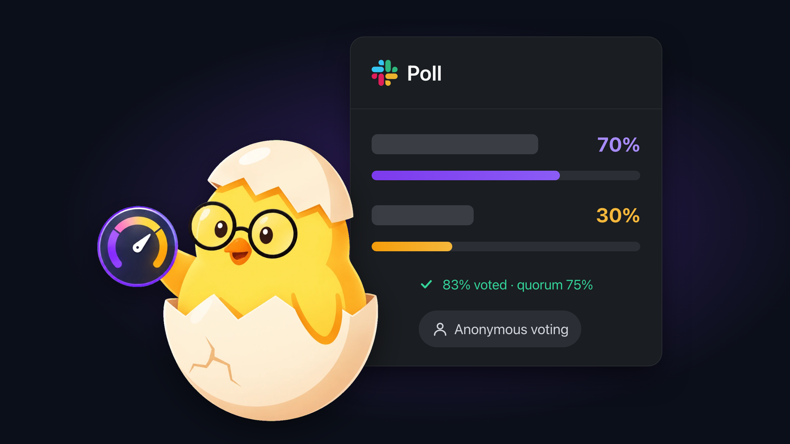

<p align="center">
  
</p>

<h1 align="center">Pollito</h1>

<p align="center">
  <strong>Polls that close at quorum.</strong><br>
  Public or anonymous Slack polls that close when enough of your team has voted.
</p>

<p align="center">
  <a href="https://pollito.tbelt.online/slack/install"></a>
  <a href="https://pollito.tbelt.online"></a>
  <a href="https://pollito.tbelt.online/es/"></a>
  <a href="https://pollito.tbelt.online/status/"></a>
</p>

<p align="center">
  
  
  
  
  <a href="LICENSE"></a>
</p>

Pollito runs polls inside Slack and closes them for you. Set a quorum, a deadline, or both. When the target is met, the poll closes and posts the result, or the tie, in its thread.

---

## Getting started

1. **Install.** A workspace admin clicks **Add to Slack** above and approves the permissions listed below.
2. **Create a poll.** Type `/pollito` in any channel, fill in the question and options, and choose how it should end: at a participation target, at a deadline, or both. Pollito joins public channels on its own. In a private channel, invite it first with `/invite @Pollito`.
3. **Let people vote.** The poll is one message in the channel. Votes update it in place, with counts and progress bars.
4. **Done.** When the quorum or deadline is reached, the poll closes and the result, or the tie, is posted in its thread.

Open the **Pollito** app in your sidebar to see active polls, history, participation stats, and reusable templates in App Home.

## What it does

- **Public or anonymous polls.** Public polls show who picked what. Anonymous polls use a double-urn ballot: the record that a user voted and the option they chose are stored separately, with no link between them. Tokens are derived with HKDF-SHA256.
- **Quorum or deadline.** Set a participation target from 51% to 100% of channel members, a deadline from 15 minutes to 7 days, or both.
- **Nudges for non-voters.** A private DM goes only to people who have not voted. It never reveals who has, and it is limited to one nudge every 4 hours per poll.
- **Live results.** The poll card is edited in place. Updates are debounced (800 ms, 2 s maximum) to stay within Slack rate limits.
- **Huddle polls.** Post a poll into a Huddle thread, and Pollito can remind the channel when the Huddle ends.
- **Templates and export.** Save reusable polls, share them with the workspace, and export results as CSV from App Home.
- **Single or multiple choice**, manual close by the creator, and English or Spanish based on each user's Slack language.

## Commands

Type `/pollito` and Slack suggests every action. Each subcommand is also available as its own command.

| Command | Also available as | What it does |
| --- | --- | --- |
| `/pollito` | | Opens the poll creation modal |
| `/pollito huddle` | `/pollito-huddle` | Creates a poll in the current Huddle thread |
| `/pollito report` | `/pollito-report` | Shows participation and results |
| `/pollito close [poll-id]` | `/pollito-close` | Closes a poll you created |
| `/pollito nudge [poll-id]` | `/pollito-nudge` | DMs the people who have not voted |
| `/pollito help` | | Lists commands |

---

## Privacy and security

Pollito is source-available so that admins and security reviewers can read exactly how votes, tokens, and data are handled.

- **Anonymous ballots stay anonymous.** In anonymous polls no table links a user ID to an option.
- **No third-party AI.** Poll questions, answers, and user data are never sent to external AI services.
- **Data minimization.** Pollito stores poll questions, option text, vote counts, quorum targets, and timestamps. It does not store channel message content.
- **Tokens encrypted at rest.** Each workspace's bot token is stored with AES-256-GCM.
- **Uninstall removes your data.** When the app is uninstalled, the workspace and its polls are deleted.
- **Verified requests.** Every incoming Slack request is checked against the signing secret.

## Slack permissions

These are the scopes in [`manifest.json`](manifest.json) and what each one is used for.

| Scope | What Pollito uses it for |
| --- | --- |
| `commands` | The `/pollito` slash commands |
| `chat:write` | Posting and updating poll cards, results, and reminders |
| `chat:write.public` | Posting a poll in a public channel Pollito has not joined yet |
| `channels:join` | Joining public channels where a poll is created |
| `channels:read`, `groups:read`, `mpim:read`, `im:read` | Listing conversation members to calculate quorum |
| `channels:history`, `groups:history`, `mpim:history`, `im:history` | Detecting when a Huddle starts and ends, so Huddle polls and end-of-Huddle reminders work. Message text is not stored. |
| `im:write` | Sending private nudges to people who have not voted |
| `users:read` | Reading each user's language and workspace role (admin, owner) |

## Verify the code

The test suite covers voting, quorum, anonymity, authorization, localization, and the Slack views. To run it:

```bash
pnpm install
pnpm db:generate
pnpm test
```

You need Node.js 22 and pnpm. Tests use a local SQLite file and mock the Slack API.

## Languages

English and Spanish. Pollito picks the language from each user's Slack settings, and admins can set a workspace default in Settings.

## Documentation

- [CHANGELOG.md](CHANGELOG.md): release history
- [docs/guidelines](docs/guidelines/): coding, security, UI, i18n, and editorial standards
- [Support](https://pollito.tbelt.online/support.html) and [status](https://pollito.tbelt.online/status/)

## License and security

Pollito is source-available under the [Pollito Source-Available & Audit License](LICENSE). You can inspect and audit the code. Copying, derivative works, hosting, and redistribution are not permitted.

Report vulnerabilities as described in [SECURITY.md](SECURITY.md).
