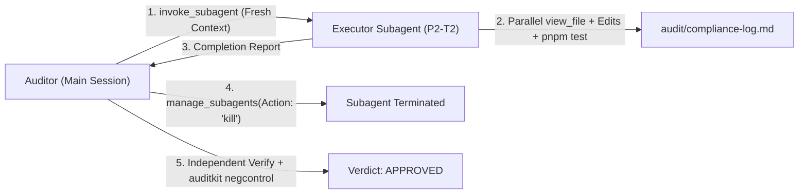

# Subagent Orchestration, Session Isolation & Model Governance

This document defines the operational protocol for orchestrating specialist subagents (`slack_buddy`, `wordsmith`, `vps_guardian`, `research`) in Pollito under the **Auditor/Executor Protocol** (`auditkit`).

---

## 1. Role Separation & Task Division

All multi-phase work and critical boundaries (cryptography, OAuth 2.0, Bolt transport, Block Kit rendering, database migrations, VPS infrastructure, and public copy) follow strict role separation:

| Role | Agent Identity | Responsibilities | Forbidden Actions |
| :--- | :--- | :--- | :--- |
| **Auditor (Orchestrator)** | Primary Agent | • Decompose scope into numbered tasks (`P<N>-T<M>`) and negative-control gates (`P<N>-G<M>`) in `audit/execution-guide.md`.<br>• Spawn isolated Executor subagents.<br>• Independently re-run verification commands and `auditkit negcontrol` mutations.<br>• Sign off `APPROVED` verdicts in `audit/compliance-log.md`. | • Writing feature code directly during an audited phase.<br>• Trusting an Executor's report without re-running tests and negative controls. |
| **Technical Executor** | `slack_buddy` | • Implement exactly one assigned task (`P<N>-T<M>`) at a time across `src/`, `prisma/`, `scripts/`, and `tests/`.<br>• Run `pnpm test && pnpm build` and log literal output in `audit/compliance-log.md`. | • Batching multiple tasks in one run.<br>• Re-reading closed phase files outside the task's target file list. |
| **Editorial & Release Executor** | `wordsmith` | • Audit and polish user-facing prose (`public/*.html`, `PRODUCT.md`, `OPERATIONS.md`, `CHANGELOG.md`, Slack Block Kit microcopy).<br>• Enforce `no-ai-slop`, `copy-editing`, and Keep a Changelog 1.1.0 standards.<br>• Draft release notes and Conventional Commits. | • Introducing binary contrasts (*"not X, but Y"*), colon reveals, em-dashes in UI labels, or voseo in Spanish docs. |
| **Infrastructure & SRE Executor** | `vps_guardian` | • Supervise `mi-vps` processes (`pm2 status`, `pm2 logs --nostream`, `pm2 restart <app> --update-env`).<br>• Validate Nginx configs (`nginx -t`) and reload without downtime.<br>• Audit file permissions (`chmod 600` on `.env`) under the Blind-Secret protocol.<br>• Verify SQLite WAL durability, atomic zero-lock backups (`sqlite3 .backup`), `/healthz`, and self-hosted GitHub Actions runners. | • Printing or reading plaintext secret values from `.env` into chat logs.<br>• Running destructive server operations without rollback safety. |
| **Read-Only Explorer** | `research` | • Broad codebase or external documentation surveys when context isolation is needed. | • Modifying files or running state-mutating commands. |

---

## 2. Ephemeral Session Lifecycle (`1 Task = 1 Fresh Subagent`)

Reusing a single Executor subagent across multiple tasks causes progressive context bloat, higher input-token latency, and instruction drift.



### Mandatory Lifecycle Rules
1. **Fresh Spawn per Task**: Invoke a new subagent via `invoke_subagent` for each individual task (`P1-T1`, `P1-T2`, `P2-T1`, etc.). Never send a second implementation task to a previously used Executor via `send_message`.
2. **Self-Contained Prompt Embedding**: Embed the exact task specification from `audit/execution-guide.md` directly inside the `invoke_subagent` prompt so the subagent does not waste turns reading planning documents.
3. **Immediate Termination on Delivery**: As soon as a subagent returns its completion report, terminate it via `manage_subagents(Action: "kill", ConversationIds: [...])` before auditing or spawning the next task.

---

## 3. Mandatory Prompt Performance Directives (`CRITICAL PERFORMANCE DIRECTIVES`)

Every `invoke_subagent` prompt must include the following block at the top to prevent out-of-scope file exploration and sequential tool-call bottlenecks:

```markdown
CRITICAL PERFORMANCE DIRECTIVES (MANDATORY):
1. Do NOT read `audit/execution-guide.md`, `audit/plan-of-record.md`, or any closed files from prior phases. The complete specification for your task is embedded below.
2. Batch your `view_file` calls in parallel (5–8 files per turn) instead of reading files one by one sequentially.
3. Read ONLY the target files listed in this task before editing them.
```

---

## 4. Model Selection Matrix (`inherit` vs. `flash`)

Subagent model selection in `invoke_subagent` (`Model: "inherit"` vs. `Model: "flash"`) is governed by empirical telemetry collected during the `v0.2.0` audit (`transcript.jsonl` analysis):

### Empirical Benchmark (`v0.2.0` Audit Telemetry)

| Configuration | Task & Scope | Files Modified | Initial Read Time | Out-of-Scope Reads | Transcript Steps | Total Wall Time | Time per File |
| :--- | :--- | :---: | :--- | :---: | :---: | :---: | :---: |
| **`inherit` (Standard Prompt)** | `P1-T1`, `P1-T2`, `P2-T1` | 3–6 | ~1m 05s (sequential) | 1–2 files | 22–38 | 3m 42s – 5m 55s | ~55s / file |
| **`flash` (Standard Prompt)** | `P2-T2` (Handlers + Tests) | 5 | **3m 29s** (16 sequential) | **6 files + duplicates** | **79** | 7m 52s | 1m 34s / file |
| **`inherit` (Restricted + Parallel)** | `P3-T1` (Block Kit UI + App Home + 2 Test Suites) | 8 | **25s** (7 in parallel) | **0 files** | **42** | 8m 39s | 1m 04s / file |
| **`flash` (Restricted + Parallel)** | `P4-T1` (Scripts + Docs + HTML + SemVer) | **19** | **16s** (7 + 8 in parallel) | **0 files** | **155** | 10m 34s | **33s / file** |

### Decision Rules for Model Selection

1. **Use `Model: "inherit"` (with `CRITICAL PERFORMANCE DIRECTIVES`) when**:
   - The task requires deep multi-file TypeScript architecture, cryptographic logic (`crypto.ts`, `pollService.ts`), complex Slack Bolt/Block Kit state machines (`pollMessage.ts`, `appHome.ts`, `updateQueue.ts`), or intricate Vitest mocking.
   - **Why**: `inherit` plans cohesive full-file edits in a single pass (~42 transcript steps for 8 files) without excessive thinking spikes or fragmented micro-edits.
2. **Use `Model: "flash"` (strictly paired with `CRITICAL PERFORMANCE DIRECTIVES`) when**:
   - The task is mechanical, well-bounded, or spans a high volume of configuration, script, or documentation files (e.g., updating 15–20 Markdown/HTML/shell files in `P4-T1`).
   - **Why**: With parallel `view_file` batching and scope locks enforced in the prompt, `flash` reads 15 files in 16 seconds and achieves **33 seconds per file**. Never run `flash` without `CRITICAL PERFORMANCE DIRECTIVES`, or it will over-explore out-of-scope files and spike thinking tokens.
